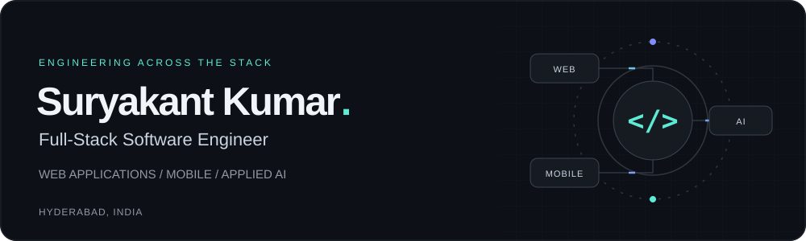

  

  
  
  

<b>3+ years building software · Hyderabad, India · Open to full-stack opportunities</b>

### AI-Native Full-Stack Developer

I build **AI products, multi-tenant SaaS, and offline-first mobile applications**, taking features from interface and API design through deployment. My stack spans **React, Next.js, TypeScript, Node.js, Python/FastAPI, Java, and PostgreSQL**.

Currently a **Software Engineer at WINIT**; previously at **Atomstate Technologies**. My work combines LLM integrations and retrieval pipelines with secure APIs, real-time systems, and production performance improvements.

## Selected engineering work

<table>
<tr>
<td width="50%" valign="top">
<h3>01 / AI Website Generator SaaS</h3>

Natural-language prompts to complete websites, with multiple LLM providers and structured outputs.

<b>Engineering:</b> RAG with document chunking, embeddings, and vector search to retrieve templates, components, and user context. Secure accounts, plan management, an admin panel, and Razorpay payments.

<code>Next.js</code> <code>TypeScript</code> <code>Node.js</code> <code>Python</code> <code>RAG</code> <code>AWS</code>

<a href="https://portal.nextgendigitalcraft.com/">Explore product ↗</a>

</td>
<td width="50%" valign="top">
<h3>02 / AI Interview &amp; Transcription</h3>

Live interview audio and transcripts streamed over WebSockets, supporting <b>50+ concurrent sessions</b>.

<b>Engineering:</b> OpenAI Whisper speech-to-text, async FastAPI services, MongoDB session and transcript storage, Docker, and automated delivery with GitHub Actions.

<code>React</code> <code>Next.js</code> <code>FastAPI</code> <code>Whisper</code> <code>WebSockets</code>

</td>
</tr>
<tr>
<td width="50%" valign="top">
<h3>03 / Real-Time Call Translation</h3>

Live transcription and translation across <b>10+ Indian languages</b>, with end-to-end latency <b>under 2 seconds</b>.

<b>Engineering:</b> Bhashini integration, WebSocket audio streaming, live session management, transcript persistence, and AWS deployment.

<code>Python</code> <code>FastAPI</code> <code>MongoDB</code> <code>Bhashini</code> <code>AWS</code>

<a href="https://suryakantkumardev.github.io/#voice-project">Project overview ↗</a>

</td>
<td width="50%" valign="top">
<h3>04 / Multi-Tenant Sales Platform</h3>

Enterprise sales workflows serving <b>1,000+ users</b> and processing <b>5,000+ orders per day</b>.

<b>Engineering:</b> JWT/OAuth 2.0, RBAC, tenant isolation, validated APIs, orders, invoicing, returns, and dashboards. SQL indexing and pagination reduced report load time from <b>~9s to under 3s</b>.

<code>React</code> <code>Next.js</code> <code>Java</code> <code>Node.js</code> <code>PostgreSQL</code>

</td>
</tr>
<tr>
<td width="50%" valign="top">
<h3>05 / Offline-First Field Sales</h3>

Mobile workflows enabling <b>500+ field reps</b> to capture orders, returns, and stock without connectivity.

<b>Engineering:</b> Local capture, background sync queues, automatic retry, and synchronization on reconnect. Reduced sync failures by <b>40%</b>.

<code>React Native</code> <code>Expo</code> <code>Redux Toolkit</code> <code>REST APIs</code>

<a href="https://suryakantkumardev.github.io/#mobile-project">Project overview ↗</a>

</td>
<td width="50%" valign="top">
<h3>06 / Developer Portfolio</h3>

A responsive showcase of my engineering work, built with HTML, CSS, and JavaScript.

<b>Engineering:</b> Accessible navigation, reduced-motion support, progressive enhancement, and an email-draft contact flow.

<code>JavaScript</code> <code>HTML</code> <code>CSS</code>

<a href="https://suryakantkumardev.github.io/">Visit website ↗</a> · <a href="https://github.com/suryakantkumarDev/Suryakantkumardev.github.io">Source code</a>

</td>
</tr>
</table>

Selected personal and professional work. Employer-owned source code is not published here.

## Technology toolkit

| Area | Technologies and practices |
| :--- | :--- |
| **Frontend & mobile** | React · Next.js · TypeScript · JavaScript · React Native · Expo · Redux Toolkit · Tailwind CSS |
| **Backend** | Node.js · Express · Python · FastAPI · Java · REST APIs · WebSockets · Microservices · Multi-tenant SaaS |
| **AI & retrieval** | OpenAI · Gemini · Claude · Open-source LLMs · RAG · Embeddings · Vector search · Prompt engineering · Context management · Whisper · Bhashini |
| **Security & payments** | JWT · OAuth 2.0 · RBAC · Input validation · Tenant isolation · OWASP-aware secure coding · Razorpay |
| **Data** | PostgreSQL · SQL tuning & indexing · MySQL · MongoDB · Redis · Firebase Firestore · Elasticsearch |
| **Cloud & delivery** | AWS: EC2, S3, CloudFront, API Gateway · Azure · Docker · GitHub Actions · Railway · Git |

## Professional experience

### WINIT — Software Engineer
**July 2025 – Present · Hyderabad, India**

- Deliver web, mobile, and backend features for a multi-tenant sales force automation platform serving **3 global enterprise clients and 1,000+ users**.
- Build offline-first React Native workflows, secure REST APIs, role-based permissions, and tenant-level data isolation.
- Optimize PostgreSQL reports on **5M+ rows**, reducing load time from **~9 seconds to under 3 seconds**; investigate production incidents and implement root-cause fixes.
- Ship releases through CI/CD and code review, working directly with client stakeholders and internal teams.

### Atomstate Technologies — Software Engineer
**January 2023 – May 2025 · Hyderabad, India**

- Owned features from UI to API to release for customer-facing AI products using React, Next.js, Node.js, TypeScript, Python/FastAPI, and MongoDB.
- Built asynchronous interview and transcription services with Whisper and real-time WebSocket streaming for **50+ concurrent sessions**.
- Containerized services and maintained GitHub Actions pipelines, reducing deployment time from **~30 minutes to ~8 minutes**.
- Collaborated with product, QA, and DevOps in Agile sprints.

## How I build

- **AI-assisted development:** Claude Code and OpenAI Codex for implementation, testing, debugging, and documentation, with manual review for correctness and security.
- **Engineering quality:** Modular, reusable code; code review; secure input handling; production debugging; query optimization.
- **Teamwork:** Stakeholder communication, end-to-end feature ownership, and mentoring junior developers.

## Education

**B.Tech. in Computer Science and Engineering**  
Teegala Krishna Reddy Engineering College · Hyderabad, India · **2018–2022**

## Let's connect

Open to **AI-native full-stack, backend, and product engineering opportunities**.

[Portfolio](https://suryakantkumardev.github.io/) · [LinkedIn](https://www.linkedin.com/in/suryakant-kumar-developer) · [Email](mailto:suryakantkumar.dev@gmail.com)

Technology icons by <a href="https://github.com/tandpfun/skill-icons">Skill Icons</a>.
